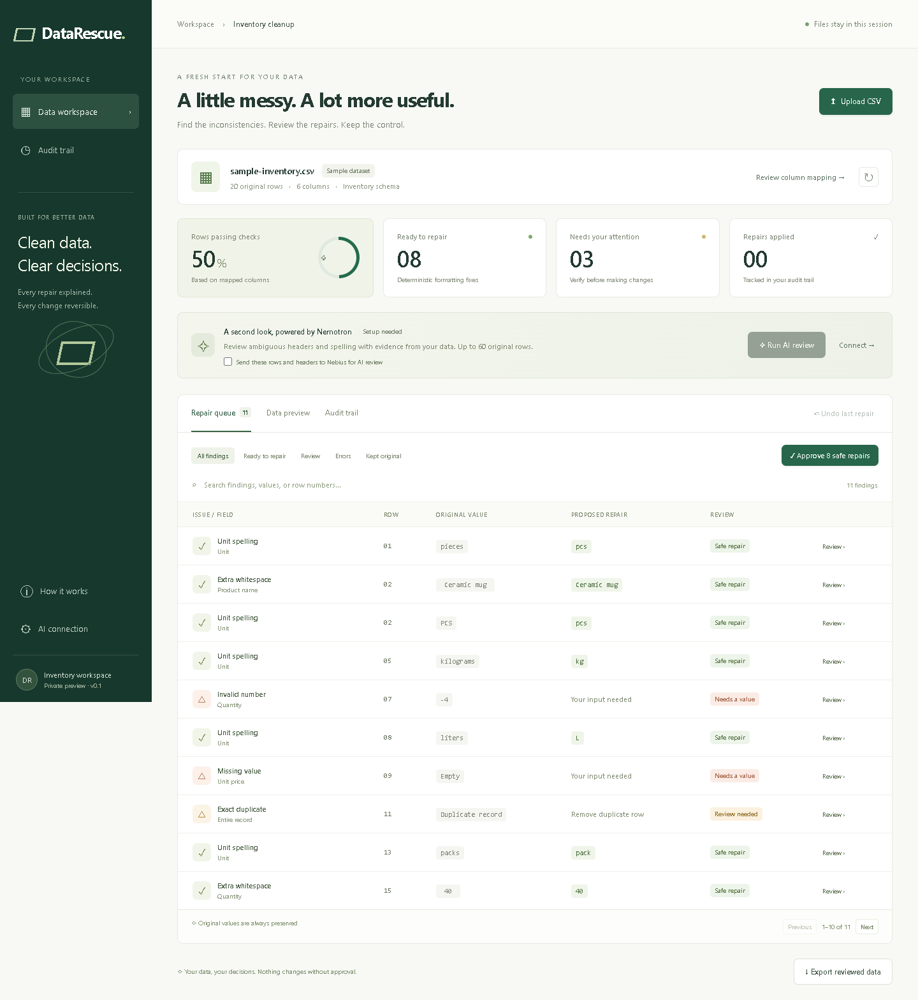

# DataRescue

**Clean inventory data, with an explanation for every repair.**

DataRescue helps small teams inspect messy inventory CSVs, approve repairs, and export reviewed data with a complete audit. Deterministic checks handle formatting; an optional NVIDIA Nemotron integration proposes contextual vocabulary corrections through Nebius Token Factory.

> **Hackathon work in progress:** Local workflows and mocked provider tests work. Live Nebius inference is not yet verified while live Nebius access is pending. Do not interpret the screenshots or mocked tests as evidence of a successful model call.



## Try it locally

Install Node.js **24 or newer**, download this repository, and open a terminal in its directory. No npm install or third-party runtime dependencies are needed.

```sh
node scripts/build-rescue.mjs
node scripts/serve-rescue.mjs
```

Open **http://localhost:5173**. The included synthetic inventory opens automatically. Stop the server with Ctrl+C. It listens only on your computer's loopback interface.

Start with **Approve 8 safe repairs**, inspect the remaining three findings, compare original data, undo a change, then export a CSV and JSON audit. See [judge testing instructions](docs/JUDGE-GUIDE.md).

## What it does

- Preserves text identifiers, Unicode, quoted CSV fields, and unknown columns.
- Lets you confirm column meanings before repairs.
- Finds extra whitespace, unit-label variants, invalid numbers, missing values, exact duplicate rows, repeated SKUs, and formula-like text.
- Applies formatting repairs only after approval; ambiguous repairs and row deletion need individual review.
- Accepts verified manual corrections and supports last-repair undo.
- Retains immutable originals and an append-only audit of session decisions.
- Exports a reviewed CSV with unresolved findings disclosed and formula-like text escaped.

## NVIDIA + Nebius integration

The backend calls Nebius Token Factory's Chat Completions endpoint with NVIDIA Nemotron. The default model is `nvidia/nemotron-3-super-120b-a12b`; confirm its exact ID and regional availability in your account. The defaults follow [Nebius's Nemotron example](https://nebius.com/services/token-factory/nemotron).

After explicit consent, the backend sends original headers and up to 60 original rows. Nemotron can infer missing column mappings and suggest name/category/unit vocabulary corrections. A validator rejects numeric and identifier changes, fabricated evidence, duplicate proposals, missing-value guesses, and unsupported columns. Every accepted proposal still requires human approval. Another row is supporting evidence, not proof of factual correctness.

Token Factory is intended to provide hosted inference without running model infrastructure ourselves. Latency, cost, model accuracy, and acceleration claims remain unmeasured until live access is available.

### Configure locally

On Windows PowerShell:

```powershell
& ./scripts/configure-nebius.ps1
```

Paste the key at the hidden prompt. Alternatively, copy `.dev.vars.example` to `.dev.vars` and edit it privately:

```sh
cp .dev.vars.example .dev.vars
```

Set `NEBIUS_API_KEY`, `NEBIUS_MODEL`, and `NEBIUS_BASE_URL`, then restart the server. The key remains server-side and `.dev.vars` is ignored by Git. Do not include credentials in screenshots, issues, or commits.

In DataRescue, check the data-sharing consent box and click **Run AI review**. “Key configured” confirms presence only; a completed request and audit event confirm inference. Provider failures never silently become simulated AI results.

## Test

```sh
node scripts/build-rescue.mjs
node --test tests/rescue.test.mjs
node scripts/validate-rescue.mjs
```

The 13 automated tests cover CSV fidelity and rejection, repair invariants, duplicate review, stale edits, numeric validation, formula escaping, AI evidence constraints, and HTTP behavior. One provider response is explicitly mocked; tests require no credentials or paid calls. A GitHub Actions workflow runs the same commands; hosted CI results will exist only after publication and execution.

Desktop and mobile workflows were also exercised in a browser during development. See [validation record](docs/VALIDATION.md) for evidence and limits.

## Architecture and limitations

`lib/` contains the shared TypeScript engine; `web/` contains the UI and backend. Node's built-in type stripping generates a self-contained Fetch API Worker plus a local Node server adapter. See [architecture](docs/ARCHITECTURE.md).

- UTF-8 comma-separated CSV only: 1 MB, 1,000 rows, 30 columns, 4,000 characters per cell.
- Data lives in browser memory and clears on refresh. Export the audit to retain your work; audit import is not implemented.
- AI reviews up to 60 original rows, not the full dataset or repaired copy.
- Unit spellings are normalized without converting quantities or physical units.
- Passing checks does not certify factual accuracy. Missing values require verified user input.
- No persistent projects, XLSX support, or collaboration in this version.
- Public deployment with a shared paid key needs authentication and durable usage limits. The existing owner-private preview is not a judge-accessible demo.

## Hackathon materials

Track: **Best Apps and Agents**.

- [Devpost description](docs/DEVPOST.md)
- [Judge guide](docs/JUDGE-GUIDE.md)
- [Demo narration and shot list](docs/VIDEO-SCRIPT.md)
- [Tool feedback](docs/FEEDBACK.md)
- [Submission checklist](docs/SUBMISSION-CHECKLIST.md)

## License

[MIT](LICENSE). NVIDIA models and Nebius services retain their own applicable terms; this repository does not redistribute model weights.
